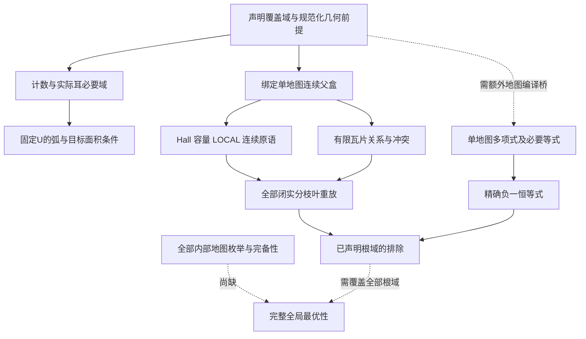

# n100剪枝接口、独立成本与组合研究交付报告

本报告对应用户要求的三步顺序：当前边界线路可复现收尾；既有剪枝清点与条件接口；独立成本预测、局部实测和组合可行性研究。完整n100最优半径及全部内部地图枚举仍未解决。

当前数学界仍是11323/100000 < r_D(100) <= 1154469548855829/10^16。本文所有成本测量不参与几何判定；接受判定使用整数、Fraction和向外有理区间。

## 1. 交付入口与证据层级

[最终登记表](../verify/out/n100-final-proof-interface-registry.json)列出16组已登记调用路径；一组可以包含多个方法。它包含292个顶层verify源的当前快照。递归旧源审计口径另见[344源清单](../verify/out/n100-pruning-recursive-inventory-v3.json)：320种内容、10组内容别名、20个家族。两个数字范围不同，不能相减来推导缺漏。

[统一快速核验器](../verify/run_n100_delivery_audit.py)已实际执行两次并退出0，首次封印467个文件，第二次在新目录读取同一封印，证据见[统一核验记录](../verify/out/n100-delivery-audit-135.json)。本总报告和随后新增的最终登记表不属于较早467文件封印，须在最后交付回执另绑定。

核验层级必须区分：

- 文件存在/哈希：证明这次消费的是哪份内容。
- 元数据/入口核验：拒绝重复节点、错域、无授权入口和无依据预算相加。
- 精确算术重放：重算某个给定域的必要条件与证书。
- 解析/几何桥：说明原覆盖配置必落入该域、必要约束成立。
- 全域覆盖：所有分支、图、标签均被枚举/包含。

前一层不能替代后一层。保存JSON的EXCLUDED字符串也不是可直接接受的证明输入，composer从proof_input重放。

## 2. 已收尾边界线路的精确范围

[边界收尾报告](result-n100-stage118-line-closure.md)与[隔离运行记录](../runtime/boundary-line-replay-118/replay.json)提供主程序和独立核验端到端证据：m99线路3601个必要边界字筛到327个，六家族，34项标量测试；两个输出与原参考逐字节一致。

它不是内部三角地图生成器，不是m100全部边界代表，不是对整个家族的全局排除。输入的B是不同规范化单弧边界胞，k是不同服务圆盘，m是有效圆盘数，满足B<=k<=m<=100。轴细分和任意边界弧不能充当B。

耳尖在步长2会重叠，应使用不交打包；实际标记耳面积替代旧kappa面积，不把两个重叠预算累加。当前U下非服务圆盘数至少58，故k<=42；404个(m,B,k)必要标签仍不是可实现地图列表。

## 3. 可执行接口与条件接口

|登记路径/方法组|输入与前提|可接受结论|证据|
|---|---|---|---|
|六种圆心盒叶：Hall、小池、盒模式、带权、自动Hall、LOCAL|闭圆心盒，平方半径；目标位于单位盘；LOCAL另需局部定理/标签/旋转|仅该盒排除或保留/未决|[叶批次1](../verify/out/n100-proof-interface-contracts-v2.json)、[批次2](../verify/out/n100-proof-interface-batch2.json)、[批次3](../verify/out/n100-proof-interface-batch3.json)|
|递归计数与实际耳|同规范化图，m/B/k区分，半径域和实际耳打包|有限必要标签域缩小|[计数契约](../verify/out/n100-count-proof-interface-contracts.json)|
|弧帽、透镜、100径向目标|固定U，规范化服务数或固定径向类型|必要预算排除；保留不等于覆盖|[弧预算契约](../verify/out/n100-arc-budget-interface-contracts.json)|
|连续原语及三站点变体|同地图/父域/坐标系/半径；向外闭实区间|空必要域排除；奇异或非空保留/未决|[连续契约](../verify/out/n100-continuous-proof-interface-contracts.json)、[变体契约](../verify/out/n100-proof-interface-variants.json)|
|有限弧支持、nogood与闭实分枝树|绑定连续父域、有限瓦片；全部子域覆盖父域|有限支持或完整已声明根域排除|[有限/树契约](../verify/out/n100-finite-tree-proof-interface-contracts-v2.json)|
|地图编译、SOS/理想负一、双轴|合法连通dart地图/固定多项式模型；非负平方与等式替换有依据|只排除该模型|[代数契约](../verify/out/n100-algebra-proof-interface-contracts.json)|
|共享受限/自由截距支持|构造器完整核验，逐次证书/源哈希，固定U|必要条件逻辑求交|[共享支持](../verify/out/n100-shared-support-session.json)|
|环带、平移目标、多锚点方差|声明圆心范数/盒域；目标包含；图路径提升另验|指定域必要面积/方差排除|[分布契约](../verify/out/n100-center-distribution-interface-contracts.json)|

四种状态为EXCLUDED、NOT_EXCLUDED、UNDECIDED、PRECONDITION_MISSING；闭半径等号保留。连续变量始终是实数，整数端点是向外包络；分枝[lo,cut]和[cut,hi]在cut交叠，不用cut+1跳过实数。

[174旧源归并清单](../verify/out/n100-legacy-rule-disposition.json)为每源登记类型、资源、前提、证书、静态依赖、函数、成本模型和缺失桥。它们的gate均经实际调用并返回PRECONDITION_MISSING。家族名字/AST相似不证明与当前接口数学等价；独立checker候选、保存域驱动和规则实现没有被合并成同等权威。

因此本交付完成这些旧源的条件接口登记，但没有逐项激活174个旧main或独立计时它们的全部扫描。若“所有剪枝都可直接调用”被理解为每个历史变体都经过新的完整语义审查，这一强要求尚未达成。当前交付对它们提供明确的拒绝、前提和迁移路线，绝不将此缺口隐藏为已验证。

## 4. 组合规则与依赖图



可串联求交：同域必要条件、已绑定父域收缩、同配置的有限标签筛选。跨表示必须有显式保守包含桥。依赖DAG必须先建立前提再消费结果。

不可直接相加：同批见证的容量亏损、多个重叠内目标面积亏损、受限与自由截距支持、实际耳与旧kappa面积。共享资源须有不交资源分配证书才可相加，目前默认禁止。

被支配不等于无效：404标签在当前U下逐项调用弧帽和透镜，808次调用没有新增排除；它们在此域边际收益为零，不能据此转移到其他半径或删去独立支持。

局部叶混合不等于全域：LOCAL只对指定标签/旋转/盒；有限瓦片的可满足支持不是连续覆盖；树必须验证根、闭分割与所有叶。单图SOS不排除其他图。

## 5. 独立复杂度和时间预测

[阶段131操作模型](result-n100-stage131-independent-timing.md)给出各有效内核的工作量与有理位长成本；[旧源逐项模型](../verify/out/n100-legacy-rule-disposition.json)把驱动总扫描代价和内核区分。以下为概括，不将未知中间位长替换成输入位长上界。

|内核|保守操作模型|尚未知或另计|
|---|---|---|
|自动Hall|O(k²+nk+kE)|见证池发现；树节点数|
|小池容量|O(2^k*k³+n*2^k+nk)|中间有理位长；池选择|
|盒模式/并集|朴素最坏O(n*4^k)|实际反链/可达模式数|
|带权容量|O(k³+n*2^k*k³)|权重发现和分布|
|计数/耳筛选|T标签乘每标签标量规则|前置357标量/超越包络核验|
|弧/径向支持|条带核验O(J*S)，热目标O(T*D)|参数优化/任意径向类型生成|
|连续/三站点|O(N*S*C)乘区间算术；三站点组数choose(d,3)|有效传播轮次、完整树N|
|有限关系/冲突|实际状态转移数；独立冲突oracle可指数|冲突发现及完整域投影|
|地图/SOS|一图按dart与稀疏项数；乘法按项数乘积|全部图数M、SOS发现|
|分布/锚点|O(n)或O(k)有理工作|范数盒建立、图路径桥|
|固定核图锚点驱动|图BFS和N放置乘面/锚点子集|只适用于声明核；全部核未知|
|上界覆盖|精确排列组合与代数根比较|独立上界流程，未以本批下界内核计时代替|

### 本机代表规模实测

首批7个不同进程、25任务、每任务预热后5次，共875次检查，结果逐次一致。[计时校准证书](../verify/out/n100-interface-timing-calibration.json)保留环境、raw-block绑定和范围。

|固定工作负载|7个block中位数的中位数|
|---|---:|
|404标签热筛选|0.806ms|
|计数上下文冷准备|1138ms|
|弧/轮廓上下文冷准备|2782ms|
|自由截距上下文冷准备|1700ms|
|实际候选20924约束单轮|636ms|
|实际有限循环|343ms|
|7节点闭实树重放|0.476ms|
|稀疏SOS验证|0.873ms|
|100圆心环带/平移目标|0.570 / 2.500ms|

时间是该输入/该实现，不是不同难度方法的公平排名。精确SOS发现、全图生成、连续全局树搜索未计时。LOCAL的约22.7ms包括链/哈希消费，未重新建立整个上游定理。

固定输入重复预测是合法的有限模型，例如相同404标签热筛选1000次约0.806秒；实际20924约束不变的1000轮约636秒。不得将其写成1000个任意新节点的无条件预测。

### 规模及位长留出

[规模实验](../verify/out/n100-composition-scaling.json)：七个进程、19任务，共665次热调用检查。Hall64目标的首批留出为28.9ms；小池k8由k7锚定2^k至2^k*k³预测24.48至43.63ms，实测38.37ms；2048位分母由512位锚定常数至二次位工作预测0.181至3.323ms，实测0.322ms。区间为工程预测，非置信区间或数学墙钟界。

位长实验中目标几何随分母变化，不能称几何完全固定。其余固定规模内核没有独立规模拟合，不套用小池位长规律。OS缓存未清空，热顺序按block seed打乱；5次热调用不是5个独立进程重复。补充分布计时固定次序，只用于描述本机工程成本。

## 6. 组合实测及可行性判断

四例公开互补语料的实际判定矩阵与成本见[阶段132报告](result-n100-stage132-composition-scaling.md)。三种容量方法并集排除三个矛盾例，交集为空，闭半径控制保留。不同例属于不同域，不相加亏损，也不乘边际成功率。

同一四例上，带权->盒模式29.04ms，逆序40.42ms，结果相同；这个排序不代表所有未知地图的最优顺序。安全composer重放三方法64.78ms，可信本地结果缓存3.62ms，后者要求同payload与源快照，不能拿来替代任意外部证书验证。

[共享支持实测](../verify/out/n100-shared-support-session.json)给出七轮成对结果：两个消费者分别核验冷准备3499ms，共享一次1718ms，约2.04倍比；逐次哈希检查后四输入热调用34.76ms。改半径、改预期哈希、改内容快照和调用方修改返回绑定四项控制均通过。当前源码与Python已加载字节码对应性仍依赖本地稳定执行环境，未提供对并发恶意改写的原子文件系统保证。

实际可行组合是：先用低成本计数/结构门压缩已声明域；对同一父盒复用已核验支持；按语料实际排除矩阵选择叶顺序；必要时有限关系缩域；只对难叶分枝或代数证书。每项保持同图、同半径和父域绑定，及时失效缓存。

完整n100求解可行性目前不可可靠估算。主要缺口是完整内部地图数、根域分解与传播/分枝难度分布，不是某个热公式还不够快。计数松弛存活、有限支持存活、局部非空不能补上这些缺口。不能从这些秒/毫秒值制造全局完成时间。

## 7. 依赖纠错与复现命令

显式静态依赖审计发现一处历史脚本哈希不匹配；没有改写旧哈希。4776个配置的主/独立/历史输出逐项相等，经[完整重验证据](../verify/out/n100-boundary-circle-full-revalidation.json)与[桥接审核](../verify/out/n100-interface-dependency-bridged-audit.json)限定修复此一绑定。它不消除所有解析前提。

[九批运行依赖账本](../verify/out/n100-interface-runtime-dependencies.json)记录9个新进程证书全部逐字节一致、152个实际项目读取文件；其中加载过的pyc也登记。实际读取不证明上游定理计算重跑，字面路径候选更不证明读取。

在项目根执行下式，每次指定不存在的新目录：

```powershell
# 快速重放和当前文件封印，已实跑两次
python verify/run_n100_delivery_audit.py --run-dir runtime/my-delivery-audit
# 对同一封印复核，输出仍写新目录
python verify/run_n100_delivery_audit.py --run-dir runtime/my-delivery-recheck --manifest runtime/my-delivery-audit/manifest.json
# 九批接口完整保存输入重放，已实跑
python verify/run_n100_interface_suite.py --run-dir runtime/my-interface-suite
# 当前m99边界线路，已实跑
python verify/run_n100_boundary_line_replay.py --run-dir runtime/my-boundary-line
# 全4776算术双实现及历史对比；新目录封装本次运行结果单列收尾回执
python verify/run_n100_full_revalidation.py --run-dir runtime/my-full-revalidation
# 独立计时、规模和组合、共享准备
python verify/run_n100_interface_timing.py --run-dir runtime/my-interface-timing
python verify/run_n100_composition_scaling.py --run-dir runtime/my-composition-scaling
python verify/run_n100_shared_support_timing.py --run-dir runtime/my-shared-support
```

注意计时和部分契约脚本的最终verify/out目标是不可覆盖模式；实验复现如目标已存在，会拒绝写最终证书，虽raw进程样本可已生成。统一九批接口重放器会隔离最终输出，当前计时/规模/共享入口尚未统一隔离最终证书目标；在干净工作副本中运行这些计时脚本，或只消费已封印原始数据，不删除原始证书来迁就重跑。完整交付还欠这三条计时入口的可重复输出封装。

## 8. 未完成项和当前交付判断

研究已交付边界线路、类型化接口、递归清单、保守条件门、独立操作模型、本机校准、同域互补/顺序/缓存实证及统一快速重放。尚需收集本次全4776快照封装结果，补计时入口的输出隔离包装，并为总报告和最终登记表生成最终交付回执。

更强的“每个历史变体都可直接调用且逐源独立重放/计时”未完成；174个条件旧源仍明确拒绝新证明准入。完整n100的极小多项式、精确最优配置和全局最优性也未证明。它们不是可以通过把存活标签改名为地图、把模板改名为定理来解决的元数据问题。
